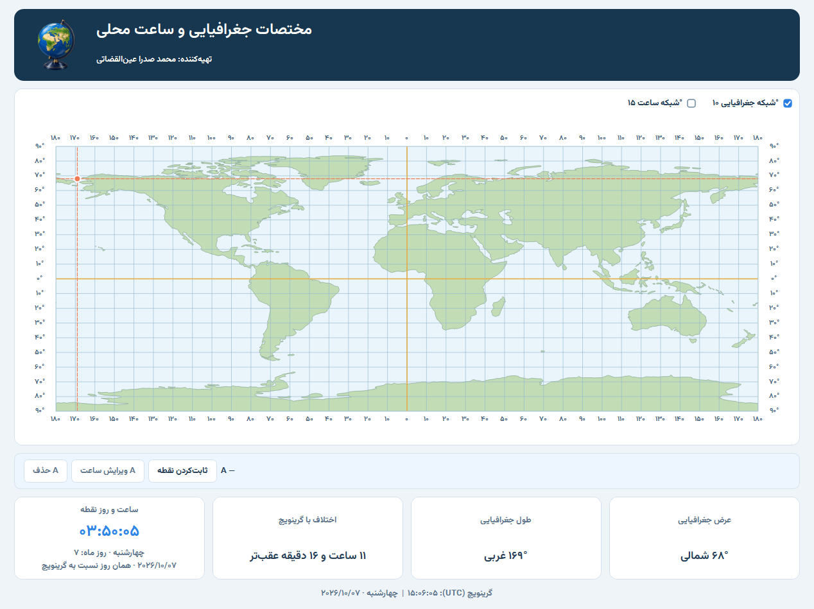

# Geography Explorer 🌍

A Persian desktop application created for lessons 1 and 2 of Iran’s ninth-grade Social Studies curriculum.

The idea is simple: make geographic coordinates and local time easier to understand through an interactive world map.



## Built With

- **Python** — application logic
- **PySide6 / Qt** — desktop interface and vector rendering
- **Natural Earth GeoJSON** — continent shapes

Designed for Windows, with a fixed-size interface and Persian text.

## Features

- Latitude and longitude displayed in 10° steps
- Northern, southern, eastern, and western coordinates
- Educational local time calculated relative to Greenwich
- Offline map and click-to-freeze selection

## Getting Started

Requires Python 3.11 or 3.12.

```sh
pip install -r requirements.txt
python main.py